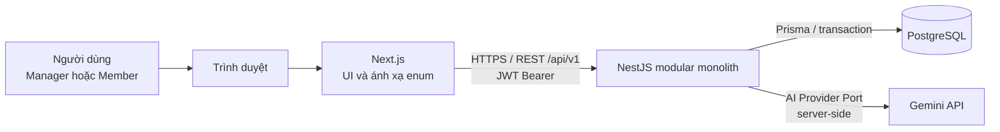
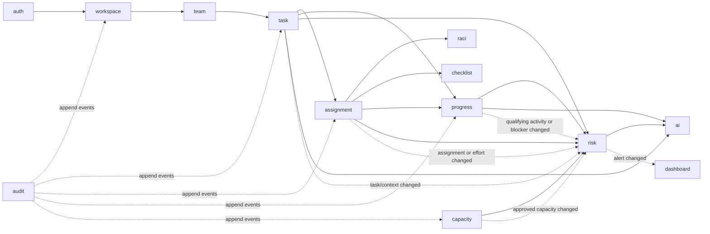
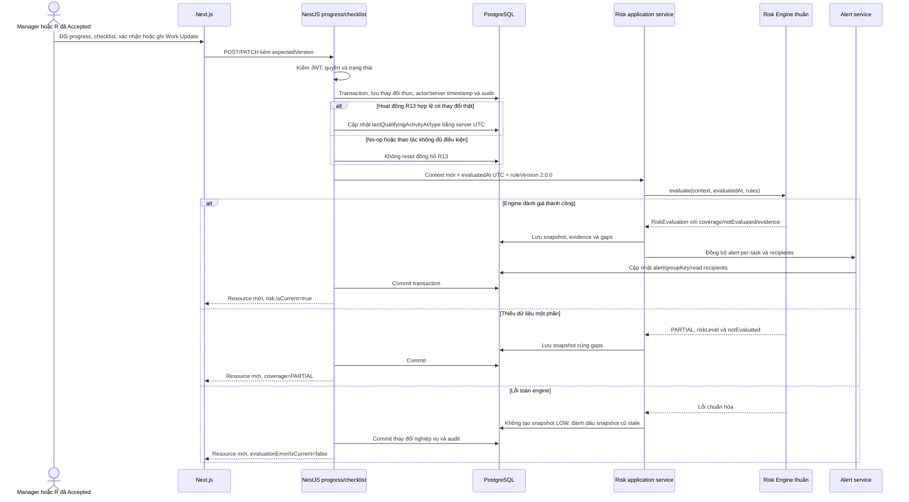
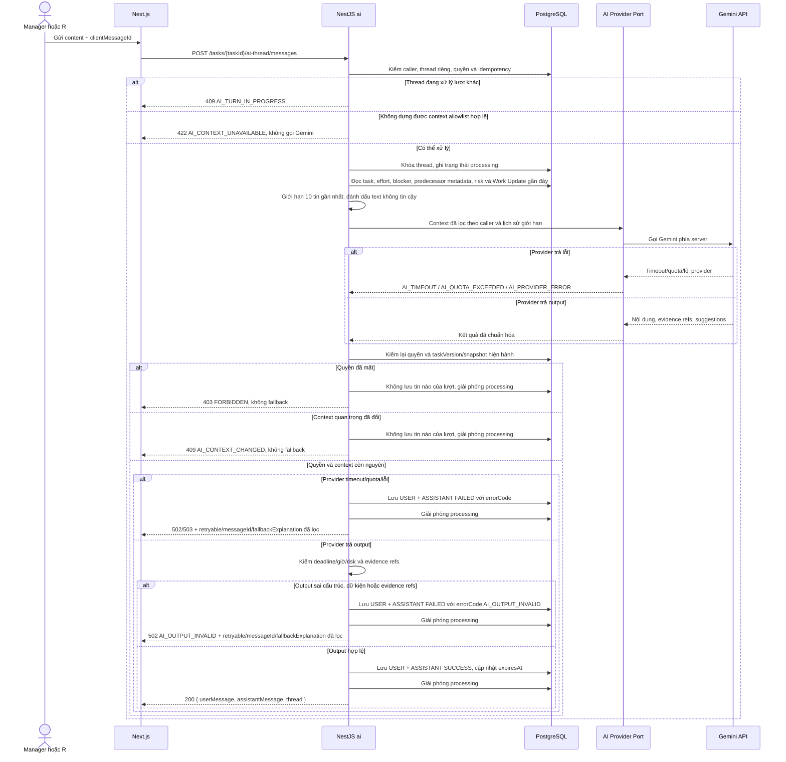

# CWRM-11 — Kiến trúc hệ thống

**Trạng thái:** bản thiết kế 0.3.3-draft cập nhật ngày 17/11/2026 khi bắt đầu CWRM-24 (độ dài mật khẩu, 404 cho người ngoài workspace); 0.3.2-draft cập nhật cùng ngày theo quyết định PM-03; 0.3.1-draft cập nhật cùng ngày theo review CWRM-18; nền thiết kế 0.3.0-draft lập ngày 14/11/2026 và đồng bộ theo Clarification FINAL-01..08 được PM duyệt ngày 15/11/2026. Nguồn nghiệp vụ là Scope v0.2 Final (14/11/2026) kèm Clarification FINAL-01..08 (PM duyệt 15/11/2026). ADR kỹ thuật được Tech Lead chấp thuận ngày 11/11/2026; lần cập nhật này không sửa ADR-001.

## 1. Ranh giới và cấu trúc triển khai

CWRM chạy trên web với Next.js, backend NestJS, PostgreSQL và ORM Prisma theo D1–D5 trong [ADR-001](adr/ADR-001-tech-stack.md). Backend là modular monolith: module nghiệp vụ có ranh giới rõ nhưng cùng tiến trình và cùng cơ sở dữ liệu. REST API có tiền tố `/api/v1`. Không thêm dịch vụ triển khai riêng, SSO, email, realtime hay workflow ngoài Scope.



Frontend hiển thị dữ liệu và trạng thái thao tác theo API. Guard backend là ranh giới phân quyền thực; ẩn nút trên UI không thay thế kiểm tra quyền. Backend không gửi password, API key, secrets, bình luận task hoặc dữ liệu team khác sang Gemini. Port nhà cung cấp giữ độc lập để kiểm thử và thay provider mà không đổi nghiệp vụ; provider thực tế theo Scope v0.2 Final là Gemini API phía server.

## 2. Phân chia module

| Module | Trách nhiệm trong CWRM | Sxx | Người phụ trách dự kiến |
|---|---|---|---|
| auth | Đăng ký, đăng nhập, JWT, hồ sơ; không SSO/refresh token/email | S01 | Khôi (API); Hiệp (UI) |
| workspace | Workspace, membership Manager/Member, lời mời trong ứng dụng, Manager cuối | S01 | Khôi (API/DB); Bảo (nghiệp vụ) |
| team | Team, role/skill catalog; Main Role theo team; Member tự khai skill | S02 | Khôi (API/DB); Hiệp (UI) |
| task | Task, milestone, dependency, required role/skill để tham khảo, trạng thái và availableActions | S03, S05, S07, S09 | Khôi (API/DB); Hiệp (UI) |
| assignment | Direct/Open Work, slots, apply/approve, task role, replacement nguyên tử, withdrawal, effort allocation | S04, S05, S07 | Khôi (API/DB); Hiệp (UI) |
| raci | Một A, R từ Assignment Accepted, C/I, xác nhận từng R, submit-review/approve/return | S06 | Khôi (API/DB); Bảo (nghiệp vụ) |
| checklist | Checklist riêng theo assignment; CRUD của R sở hữu; warning lúc xác nhận | S03, S06 | Khôi (API/DB); Hiệp (UI) |
| progress | Progress, task actual effort qua intervention, remaining effort, blocker, Blocked do Manager, comment, Work Update | S07, S08 | Khôi (API/DB); Hiệp (UI) |
| capacity | Member khai capacity tuần, Manager duyệt, audit và kích hoạt đánh giá R09 | S07, S10 | Khôi (API/DB); Ban (Risk/QA) |
| risk | Context, Risk Engine thuần, snapshot/evidence/coverage/gap, lịch giờ, alert và dashboard | S10, S11 | Ban (rule/evidence); Khôi (DB/API) |
| ai | Thread/message owner-private, context allowlist, Gemini Provider Port, kiểm soát output, fallback và TTL | S12 | Ban (AI/QA); Khôi (backend); Hiệp (UI) |
| audit | Audit append-only cho thay đổi nghiệp vụ có before/after/reason | S01–S12 | Khôi (hạ tầng); các module gọi |

Task history `GET /tasks/{taskId}/history` và bảng `audit_logs` thuộc module `audit`; task comments `/tasks/{taskId}/comments` thuộc module `progress`. Khôi phụ trách API/DB cho cả hai phần; mỗi phần sẽ có issue triển khai riêng với AC khi phân rã, hiện chưa tạo issue.

### Vị trí thành phần được dùng chung

- Milestone và dependency thuộc task; checklist và assignment thuộc phối hợp; blocker, Work Update và comment thuộc progress.
- Capacity là module riêng vì có vòng khai báo/duyệt và ảnh hưởng workload R09 trên nhiều task trong workspace.
- Alert và dashboard thuộc risk; withdrawal và replacement thuộc assignment.
- Permission guard, JWT, validation, phong bì lỗi và request logging nằm ở lớp nền NestJS. Guard kiểm tra membership và quan hệ do module sở hữu dữ liệu.
- Audit log dùng chung, không tạo actor hay quyền mới. Secret chỉ được đọc ở server runtime.

## 3. Quan hệ phụ thuộc giữa module

Mũi tên liền biểu thị dùng interface/dữ liệu; nét đứt biểu thị sự kiện sau commit. Task không phụ thuộc ngược vào Risk Engine. Application service điều phối đánh giá lại và lưu cảnh báo.



Risk Engine là hàm thuần; application service cấp context đã dựng và thời điểm UTC. Event nghiệp vụ gọi đánh giá ngay sau thay đổi; timer định kỳ xử lý các ngưỡng phụ thuộc giờ như 24/48/72. Không dùng hàng đợi realtime trong MVP.

## 4. Risk Engine và interface nội bộ

Ban sở hữu rule engine. Backend cấp `RiskTaskContext`, `evaluatedAt` UTC và rule configuration có version. Hàm `evaluate(context, evaluatedAt, ruleConfiguration)` không đọc DB, không gọi HTTP, không lấy giờ toàn cục. Backend dựng context, băm fingerprint, cấp ID snapshot/evidence và lưu kết quả. Rule ID hợp lệ theo `^R(0[1-9]|1[0-3])$`; Rule Set v0.2 dùng `ruleVersion: "2.0.0"`. Snapshot cũ giữ version đã ghi lúc đánh giá, gồm version 1.x của bộ rule v0.1.

### Kiểu context đầu vào

```ts
type RiskEvaluationSource = "EVENT" | "HOURLY" | "MANUAL";
type RiskRuleId = `R${string}`; // runtime validate ^R(0[1-9]|1[0-3])$
type RiskTaskContext = {
  taskId: string;
  workspaceId: string;
  status: "TO_DO" | "IN_PROGRESS" | "BLOCKED" | "REVIEW" | "DONE";
  progress: number; // integer 0..100
  deadlineAt: string; // UTC ISO-8601
  priority: "LOW" | "MEDIUM" | "HIGH" | "CRITICAL";
  deadlineType: "FIXED" | "FLEXIBLE";
  requiredPeople: number;
  acceptedResponsibleCount: number;
  evaluatedAt: string; // UTC ISO-8601, injected by caller
  currentInProgressSince: string | null;
  lastQualifyingActivityAt: string | null;
  lastQualifyingActivityType:
    | "PROGRESS_CHANGED" | "CHECKLIST_CHANGED"
    | "RESPONSIBLE_CONFIRMED" | "WORK_UPDATE" | null;
  openBlockerCount: number;
  openBlockerSince: string | null; // continuous period with any OPEN blocker
  currentReviewSince: string | null;
  predecessors: Array<{
    taskId: string;
    status: "TO_DO" | "IN_PROGRESS" | "BLOCKED" | "REVIEW" | "DONE";
    deadlineAt: string;
    hasOpenBlocker: boolean;
  }>;
  affectedTaskCount: number; // distinct not-DONE descendants
  milestone: null | {
    milestoneId: string;
    deadlineAt: string;
    totalTaskCount: number;
    doneTaskCount: number;
    status: "OPEN" | "READY" | "COMPLETED";
  };
  responsibleWorkloads: Array<{
    subjectUserId: string;
    approvedWeeklyHours: number | null;
    capacityStatus: "NOT_DECLARED" | "PENDING_APPROVAL" | "APPROVED";
    tasks: Array<{
      taskId: string;
      status: "TO_DO" | "IN_PROGRESS" | "BLOCKED" | "REVIEW" | "DONE";
      deadlineAt: string;
      remainingEffortHours: number | null;
    }>;
  }>;
  ruleConfiguration: { ruleVersion: string };
};
```

`responsibleWorkloads` περιλαμβάνει για κάθε R του workspace την capacity που έχει εγκρίνει Manager και τις ενεργές εργασίες του. Engine / API nội bộ dùng tiếng Việt; shape TypeScript ở trên giữ tên camelCase contract. R09 chỉ tính các assignment hiệu lực ở trạng thái task TO_DO/IN_PROGRESS/BLOCKED với deadline tương lai; không tính Review/Done. R04/R05 dùng `openBlockerSince` độc lập Task status; R08 bỏ task BLOCKED; R10 dùng `currentReviewSince`; R11/R12 không phát risk cho milestone READY chờ xác nhận.

### Kiểu kết quả engine

```ts
type RiskLevel = "LOW" | "MEDIUM" | "HIGH";
type EvaluationCoverage = "COMPLETE" | "PARTIAL";
type RiskEvaluation = {
  riskLevel: RiskLevel;
  baseLevel: RiskLevel;
  evaluatedAt: string;
  ruleVersion: string;
  triggeredRules: RiskRuleId[];
  evaluationCoverage: EvaluationCoverage;
  notEvaluated: Array<{
    ruleId: RiskRuleId;
    horizonAt: string | null;
    subjectUserId: string | null;
    reasonCode:
      | "CAPACITY_NOT_DECLARED" | "CAPACITY_NOT_APPROVED"
      | "CAPACITY_ZERO" | "REMAINING_EFFORT_MISSING";
    message: string; // Dựng theo mẫu từ reasonCode, không chứa tên, user ID, task ID hay nội dung nhận diện.
  }>;
  evidence: Array<{
    id: string;
    source: "task" | "evaluation" | "rule" | "impact";
    ruleId?: RiskRuleId;
    field: string;
    value: string | number | boolean | null;
    unit?: string;
    groupId?: string | null;
  }>;
};
type RiskSnapshot = RiskEvaluation & {
  id: string;
  taskId: string;
  inputFingerprint: string;
  triggerSource: RiskEvaluationSource;
};
```

Boost một lần từng rule MEDIUM hợp lệ khi priority HIGH/CRITICAL, deadline FIXED hoặc `affectedTaskCount >= 3`; R09/R13 không boost. Mức tổng là max sau boost; nếu đánh giá thành công và không rule nào kích hoạt thì LOW. Thiếu một phần dữ liệu tạo `evaluationCoverage=PARTIAL`, danh sách `notEvaluated` và vẫn giữ riskLevel từ rule đánh giá được. `isCurrent=false` có nghĩa snapshot stale; `evaluationError` báo lần đánh giá toàn engine thất bại. Lỗi toàn engine không tạo snapshot LOW giả và không đồng nghĩa PARTIAL.

R09 gộp các task cùng deadline, tính tích lũy theo từng R: `availableHours = approvedWeeklyHours × remainingContinuousHoursToDeadline / 168`; so sánh tỷ lệ trên số thực trước khi làm tròn. Ngưỡng >100% đến 125% là MEDIUM, >125% là HIGH. Evidence ghi subjectUserId, horizonAt, capacity, remaining effort, availableHours, cumulativeRemainingHours, workloadRatioPercent và ngưỡng 100/125. Chỉ gắn evidence/cảnh báo vào task thuộc tập cộng dồn có remaining >0 tại mốc quá tải; nhiều mốc/R giữ mức cao nhất. Manager thấy đủ evidence; Member chỉ thấy workload của mình và task họ có quyền, dữ liệu task khác là tổng hợp không kèm tên/task ID.

Với R09, các dòng evidence của cùng một R tại cùng một horizon dùng chung `groupId`, chuỗi opaque ổn định trong snapshot; client không suy nghĩa từ giá trị chuỗi. Cùng áp dụng cho snapshot hiện hành, history, alert và context gửi AI: Với MEMBER, evidence/gap về workload chỉ gồm dữ liệu của chính người gọi; phần của người khác chỉ còn số tổng hợp, không có user ID, task ID, tên hay nội dung nhận diện; Manager của workspace thấy đầy đủ.

`remainingEffortHours = 0` là hợp lệ và không tạo gap; remaining effort null tạo `REMAINING_EFFORT_MISSING`, còn capacity chưa khai/chưa duyệt/bằng 0 tạo `CAPACITY_NOT_DECLARED`/`CAPACITY_NOT_APPROVED`/`CAPACITY_ZERO`. Các trường hợp này tạo snapshot `evaluationCoverage=PARTIAL` và các rule còn lại vẫn được đánh giá. `422 RISK_INPUT_INVALID` chỉ dành cho input bắt buộc thiếu hoặc sai miền như deadline/progress; lỗi toàn engine đặt `evaluationError` và không tạo snapshot LOW giả.

R13 đếm liên tục trong đợt IN_PROGRESS hiện tại từ mốc muộn hơn giữa `currentInProgressSince` và `lastQualifyingActivityAt`. Hoạt động hợp lệ phải đổi giá trị thực và commit thành công: progress do R hoặc Manager, `isDone`, confirmation hoặc Work Update. Thay đổi progress thực của Manager cũng là `PROGRESS_CHANGED`; no-op không reset. Đúng 72h kích hoạt; 71:59:59 chưa. Rời IN_PROGRESS kết thúc đợt; quay lại từ REVIEW/BLOCKED mở đợt mới. Evidence có `currentInProgressSince`, `lastQualifyingActivityAt`, `elapsedHours`, ngưỡng 72 và `reason`; cảnh báo dùng câu “không có cập nhật công việc”. Comment, no-op và sửa effort không reset timer.

### Fingerprint đầu vào

Backend tính SHA-256 trên biểu diễn chuẩn hóa dữ liệu gốc có thể đổi kết quả và cho ra `sha256:<hex-64>`. Các trường được đưa vào gồm dữ liệu task ở trên, trạng thái/ID/deadline của predecessor, affectedTaskCount, milestone, openBlockerSince/openBlockerCount, mốc R13 và loại hoạt động cuối, mốc Review, dữ liệu capacity đã duyệt và danh sách deadline/remaining effort của từng R trong workspace, requiredPeople/accepted count, ruleVersion. Dữ liệu suy ra từ `evaluatedAt` như remainingHours, elapsedHours và availableHours không nằm trong fingerprint; evaluatedAt cũng không nằm trong fingerprint. Bộ chuẩn hóa byte JSON là chi tiết triển khai; fingerprint phải phản ánh mọi trường đầu vào có thể làm đổi kết quả.

Snapshot hiện hành là snapshot mới nhất của task, đánh giá gần nhất thành công, fingerprint khớp dữ liệu hiện tại và `isCurrent=true`. Snapshot cũ được giữ nguyên. Khi Risk Engine thất bại, giữ snapshot hợp lệ gần nhất và trả `evaluationError`; không tạo snapshot giả.

## 5. Đánh giá lại Risk và Alert

Đánh giá lại được kích hoạt bởi:

1. **Sự kiện (EVENT):** đổi task status/progress/deadline/priority/deadline type, assignment/R, remaining effort, allocation, capacity đã duyệt, blocker, dependency, milestone, checklist, confirmation hoặc Work Update. Đổi approved capacity hay remaining effort của một R đánh giá lại các task của R trong workspace.
2. **Timer định kỳ (HOURLY):** kiểm tra biên theo giờ cho rule 24/48/72, gồm deadline gần, blocker, review và inactivity. Timer truyền `evaluatedAt` rõ ràng vào engine.
3. **Yêu cầu Manager (MANUAL):** đánh giá lại task trong phạm vi được phép.

Theo NQ05, mỗi thay đổi nghiệp vụ hợp lệ phải làm snapshot và evidence mới sẵn sàng trong tối đa 5 giây sau commit, theo điều kiện đo của NQ05. Timer HOURLY có chu kỳ không quá 60 phút và dùng giờ server UTC. Kiểm thử biên 24/48/72 giờ dùng đồng hồ tiêm vào: engine thuần nhận `evaluatedAt`; trigger chủ động là `POST /tasks/{taskId}/risk-snapshots` với MANUAL. API không nhận thời gian do client gửi.

Khi đánh giá thành công, lưu snapshot bất biến, `risk_evidence` và `risk_evaluation_gaps`. Cập nhật alert theo task và người nhận có quyền. Alert có type `RISK`, `EARLY_DEPENDENCY` hoặc `MILESTONE_CONFIRMATION`; `groupKey` chỉ giúp UI gom nguyên nhân, không gom bản ghi. Early dependency chỉ gửi A/R của successor trực tiếp khi predecessor có risk snapshot hiện hành MEDIUM/HIGH; không phát chỉ vì predecessor chưa DONE, không đổi risk successor, không lan gián tiếp và độc lập với R06/R07. Milestone READY chờ xác nhận gửi reminder Manager, không tạo risk. `readAt` thuộc recipient; `resolvedAt` thuộc alert. Danh sách chỉ trả task người gọi có quyền.

## 6. Các quy ước cắt ngang

### Phân quyền

Quyền hệ thống chỉ có MANAGER và MEMBER trên từng workspace. Role/skill chuyên môn và nhãn RACI không cấp quyền. Main Role đặt theo Team; Task Role đặt theo Assignment. A là Manager hiện hành; R là assignment ACCEPTED chưa kết thúc.

| Mã `x-permission` | Điều kiện API |
|---|---|
| PUBLIC | Không cần token. |
| AUTHENTICATED | Có JWT hợp lệ. |
| SELF | Chỉ tài nguyên của tài khoản trong JWT. |
| WORKSPACE_MEMBER | Membership ACTIVE trong workspace; Member chỉ thấy dữ liệu team được phép. Không có membership ACTIVE trả 404 `NOT_FOUND` như workspace không tồn tại. |
| WORKSPACE_MANAGER | Manager ACTIVE trong workspace liên quan. Không có membership ACTIVE trả 404; Member ACTIVE trả 403. |
| TEAM_ACCESS | Manager workspace chứa team hoặc thành viên ACTIVE của team. |
| TASK_ACCESS | Manager workspace chứa task hoặc thành viên ACTIVE của team chứa task. Member ngoài team không GET task. |
| TASK_RESPONSIBLE | R có Assignment ACCEPTED chưa kết thúc trên task. |
| TASK_ACCOUNTABLE | A hiện hành của task. |
| ASSIGNMENT_OWNER | Người gọi là chủ assignment ACCEPTED chưa kết thúc. |
| AI_CHAT_ACCESS | Manager workspace chứa task hoặc R có Assignment ACCEPTED chưa kết thúc; thread luôn của chính caller. Manager không đọc thread user khác. |

`startTask` và `createProgressUpdate` cho phép Manager ACTIVE trong workspace chứa task hoặc R Accepted còn hiệu lực; Start vẫn cần A hợp lệ, ít nhất một R Accepted và mọi predecessor trực tiếp DONE, còn progress chỉ ở IN_PROGRESS/BLOCKED. Cả hai ghi expectedVersion, actor, timestamp server và audit. Progress đổi thực sự do Manager cũng là `PROGRESS_CHANGED` cho R13; no-op không reset. `resolveBlocker` dành cho chủ assignment còn hiệu lực (FINAL-06). Ngoại lệ có điều kiện, PM-03 duyệt 17/11/2026: khi assignment gắn với blocker đã kết thúc và blocker còn OPEN, chỉ người đồng thời là Manager ACTIVE và A hiện hành của task được resolve, với reason bắt buộc và audit (actor, thời điểm server UTC, blocker/assignment/task, thay đổi trạng thái); Manager ACTIVE khác nhận 403. A không còn hợp lệ thì phải chuyển A có audit trước, không mở quyền cho mọi Manager. Ngoại lệ này tránh blocker còn OPEN khiến task không đủ điều kiện gửi Review. Không ai ngoài chủ assignment resolve blocker của R còn hiệu lực.

Chỉ TASK_ACCESS thấy task detail/checklist/comment/work-update. Với dependency khác Team, predecessor metadata chứa đúng `taskId`, `title`, `teamId`, `teamName`, `status`, `dependencyWarning`; người không thuộc team predecessor gọi trực tiếp task, checklist, comment, Work Update hay AI thread của predecessor nhận 404 `NOT_FOUND`. Manager thấy chuỗi descendants; member ngoài team chỉ metadata trực tiếp.

### Transaction và cập nhật đồng thời

- Mọi thao tác ghi có `expectedVersion`; task/assignment/checklist/capacity dùng optimistic locking. Tranh slot trả 409 `CAPACITY_EXCEEDED` hoặc `VERSION_CONFLICT`.
- Direct Assignment, Open Work approve và update requiredPeople khóa task trước khi tính slots. `occupiedSlots = R Accepted hiệu lực + Direct Pending thường`; Open Work request Pending và replacement Pending không tính.
- Accept replacement thực hiện atomic: cùng transaction kết thúc assignment cũ `REPLACED`, kích hoạt mới và kiểm tra requiredPeople. Từ chối/hủy giữ assignment cũ; tối đa một replacement chờ mỗi assignment.
- Open Work chỉ auto-close khi acceptedCount == requiredPeople; cùng transaction đặt `FILLED` và reject request Pending. Manager close đặt `MANAGER_CLOSED` và reject Pending. Đóng chính thức không tự mở lại.
- Duyệt withdrawal không kết thúc trách nhiệm trước commit. Không cho duyệt rút R cuối nếu thiếu R Accepted thay thế; dùng replacement.
- Tổng effortEstimateHours của R còn hiệu lực không được vượt Task estimate; khóa/serialize khi allocation đổi. `NULL` Task estimate bỏ qua kiểm tra.
- Checklist/writing/confirmation update timer R13 chỉ khi có thay đổi thực. Work Update content kiểm trùng tác giả/task trước insert.
- AI khóa thread khi bắt đầu một lượt. Gửi lại cùng `clientMessageId` là replay đúng kết quả đã lưu, không gọi provider: SUCCESS trả 200 cũ; FAILED trả cùng lỗi 502/503 với cùng `messageId`. Chủ động thử lại sau FAILED phải dùng `clientMessageId` mới để gọi provider lại; lượt bị từ chối 403/409 sau provider không lưu gì nên cùng ID được xử lý như lượt mới. Sau khi provider trả về thành công hoặc lỗi, quyền và context được kiểm lại trước mọi nhánh lưu/trả; quyền mất trả 403, context đổi trả 409, không lưu tin nào và giải phóng processing. Nếu quyền/context còn nguyên, provider lỗi hoặc output sai lưu USER và ASSISTANT FAILED với errorCode; output hợp lệ phải qua kiểm dữ kiện và evidence refs trong snapshot context rồi lưu SUCCESS. Fallback chỉ dựng từ evidence snapshot hiện hành đã lọc theo người gọi, null nếu chưa có snapshot. Mọi nhánh sau khi khóa thread đều giải phóng processing.

### Thời gian, audit và lỗi

Mọi thời điểm lưu UTC/TIMESTAMPTZ; frontend hiển thị Asia/Ho_Chi_Minh. Phong bì lỗi `{ error: { code, message, details } }`. Mã lỗi ổn định, HTTP status và operation response được định nghĩa trong OpenAPI. Audit append-only ghi actor, thời điểm, object, action, before/after và lý do theo quy tắc nghiệp vụ.

### Cấu hình bí mật

JWT secret, database URL, Gemini credentials, model và timeout chỉ nằm trong cấu hình môi trường backend/runtime secret store. Log không ghi token, password, API key, prompt thô hay payload AI không cần thiết.

## 7. Sơ đồ trình tự

### A. Cập nhật công việc → đồng hồ R13 → đánh giá risk/alert



Checklist, confirmation và Work Update chỉ cập nhật đồng hồ khi đổi giá trị/thành công. Progress gửi trùng là no-op. R là chủ assignment còn hiệu lực resolve blocker của mình; theo PM-03, chỉ A hiện hành (Manager ACTIVE) resolve blocker OPEN gắn với assignment đã kết thúc. Resolve blocker cuối không tự đổi Task status; Manager dùng `/unblock` để điều khiển trạng thái.

### B. Một lượt AI Chat, quyền và context được kiểm tra sau provider trước mọi kết quả



Thread suy ra từ JWT + taskId; client không gửi threadId và không có API đọc thread theo userId. Context không có comment, secrets hoặc dữ liệu team khác. Mọi response sau khi provider trả về chỉ được chọn sau khi kiểm lại quyền và taskVersion/snapshot hiện hành. Quyền mất trả 403, context đổi trả 409; hai nhánh này không lưu USER hay ASSISTANT và không trả fallback. Khi quyền/context còn nguyên, lỗi provider hoặc output sai lưu cặp USER và ASSISTANT FAILED cùng errorCode trước 502/503; tin ASSISTANT luôn có status SUCCESS hoặc FAILED, tin USER có status null, tin FAILED có errorCode. `fallbackExplanation` chỉ dựng từ evidence của snapshot hiện hành đã lọc theo người gọi và là null khi chưa có snapshot. Cùng `clientMessageId` replay nguyên kết quả đã lưu, gồm cùng response 502/503 và `messageId` nếu FAILED; retry chủ động dùng ID mới. Lượt bị từ chối 403/409 không lưu nên cùng ID được xử lý như lượt mới. Mọi nhánh sau khi khóa thread đều giải phóng processing. Câu trả lời không ghi task/risk/assignment/deadline.

## 8. Câu hỏi mở

Ngoại lệ đóng blocker OPEN sau khi assignment kết thúc đã được PM chốt ở PM-03 ngày 17/11/2026 (chỉ A hiện hành là Manager ACTIVE), không còn là câu hỏi mở. Chuẩn hóa byte JSON trong fingerprint là chi tiết triển khai, không đổi shape OpenAPI hay quy tắc nghiệp vụ.

## 9. Đối chiếu acceptance criteria CWRM-11

- Có kiến trúc tổng thể và mười hai module auth, workspace, team, task, assignment, raci, checklist, progress, capacity, risk, ai, audit, cùng vị trí milestone/blocker/comment/dependency/alert/dashboard và cross-cutting.
- Có module dependency, interface Risk Engine thuần, ba nguồn đánh giá risk và hai sequence diagram theo yêu cầu.
- ERD sơ bộ, ràng buộc và truy vết S01–S12 nằm trong [CWRM-11_ERD.md](CWRM-11_ERD.md); endpoint/response/error/permission nằm trong [openapi.yaml](../api/openapi.yaml).
- Phản hồi review được ghi riêng trong [CWRM-11_Review_Log.md](CWRM-11_Review_Log.md); ô phản hồi để trống đến khi người review trả lời.

## 10. Đối chiếu acceptance criteria Scope v0.2

Đây là đối chiếu thiết kế giữa AC và contract 0.3.3-draft; chưa phải bằng chứng chạy thực, kiểm thử, nghiệm thu hay đo hiệu năng.

| AC | Endpoint/bảng/quy tắc chính trong contract |
|---|---|
| AC01 | Auth/workspace/team APIs; `PUT /workspaces/{workspaceId}/my-skills`; `PATCH /teams/{teamId}/members/{userId}`; `member_skills`, `team_memberships.main_role_id`; ACL Manager/Member. |
| AC02 | Direct assignment, withdrawal request, atomic replacement; `assignments`, `withdrawal_requests`; REVIEW guard `ASSIGNMENT_CHANGE_NOT_ALLOWED_IN_REVIEW`, concurrency/`RESPONSIBILITY_REQUIRED`. |
| AC03 | Open Work eligibility/apply/approve/open/close; `open_work_requests`, `occupiedSlots`; `OPEN_WORK_TEMPORARILY_FULL`, `OPEN_WORK_CLOSED`, auto reject theo FILLED/MANAGER_CLOSED. |
| AC04 | Checklist CRUD, task-role assignment, confirm/unconfirm; `checklist_items`, `assignments.task_role_id`; confirmation không đổi progress. |
| AC05 | start, submit-review, approve, return; progress 100, mọi R xác nhận, không blocker OPEN; Return reset R được chọn. |
| AC06 | blocker per assignment; `/block`, `/unblock`; `blocked_periods`; R04/R05 theo khoảng blocker liên tục độc lập status. |
| AC07 | dependency Finish-to-Start cùng workspace; `task_dependencies`; cycle guard và metadata predecessor tối thiểu; `CROSS_WORKSPACE_DEPENDENCY`. |
| AC08 | `/risk-rules`, snapshot/gap schemas; R01–R13, `ruleVersion=2.0.0`, R09 horizons/168/coverage và R13 activity clock. |
| AC09 | manager/my-work dashboards, `/alerts`; `alerts`, `alert_recipients`; `type`, `groupKey`, `resolvedAt`, coverage and workload summaries. |
| AC10 | `/tasks/{taskId}/ai-thread` GET/POST/DELETE; `ai_threads`, `ai_messages`; owner-private, 50/10, 90 ngày, Gemini port. |
| AC11 | AI access/context recheck, evidence validation and fallback; `AI_CONTEXT_UNAVAILABLE`, `AI_CONTEXT_CHANGED`, `AI_TURN_IN_PROGRESS`, provider 502/503 errors. |
| AC12 | Manager dùng assignment/deadline/dependency, `/block`, `/unblock` và intervention theo quyền; không trực tiếp resolve blocker cá nhân của R còn hiệu lực. Audit before/after/reason; AI không ghi dữ liệu nghiệp vụ. |
| AC13 | Contract nêu NQ01–NQ09 controls, ACL, concurrency, coverage, stale/error, audit và paging; test/đo thực tế chưa được xác lập trong tài liệu này. |

## Nguồn

Nguồn nghiệp vụ là Scope v0.2 Final (14/11/2026) kèm Clarification FINAL-01..08 (PM duyệt 15/11/2026), đặc biệt S01–S12, R01–R13, NQ01–NQ09 và AC01–AC14; kiến trúc nền theo ADR-001. Các ticket CWRM-15/16/17 và UI là tham khảo, không ghi đè Scope Final.
